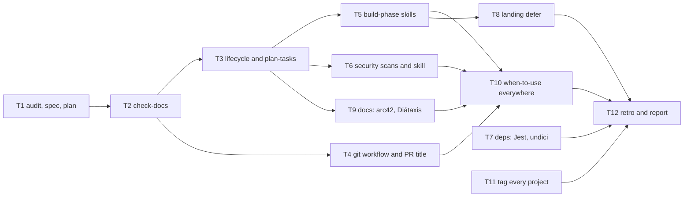

# Plan: an AI-first development process

Date: 2026-10-18. Spec: [`../specs/2026-10-18-ai-first-dev-process.md`](../specs/2026-10-18-ai-first-dev-process.md).
Audit: [`../specs/2026-10-18-audit.md`](../specs/2026-10-18-audit.md). Mode: autonomous (spec A1).

Each task is one pull request on its own branch and worktree, squash-merged when the required
checks are green and the branch is up to date. "Proves it" is the command whose output goes in the
PR body. `[P]` marks a task that shares no file with another open task and can run beside it.

## Dependency graph

T7 and T11 depend on nothing and run in parallel with everything `[P]`. T3 and T4 share no file and run in parallel after T2. T5, T6 and T9 all add a name to the skill lists, so they go one after another.

## Tasks

| #   | Branch                              | Scope        | Files (about)                                                                                                                                                                            | Covers              | Proves it                                                                                                                                      | Depends on     |
| --- | ----------------------------------- | ------------ | ---------------------------------------------------------------------------------------------------------------------------------------------------------------------------------------- | ------------------- | ---------------------------------------------------------------------------------------------------------------------------------------------- | -------------- |
| T1  | `docs/ai-first-audit-and-plan`      | docs         | the audit, this spec and plan                                                                                                                                                            | -                   | `npm run format:check` (`docs/superpowers` is not built by the site)                                                                           | -              |
| T2  | `chore/repo-check-docs`             | `repo`       | `scripts/check-docs.mjs`, its test, `package.json`, `ci.yml`, `CONSTRAINTS.md`, `.claude/settings.json`, 4 skills' frontmatter, ADR 0021–0024 status, `development-process.md` (3 names) | R1, F4–F6           | `npm run check:docs` red on a planted dead link, green on the tree; `npm run test:scripts`                                                     | T1             |
| T3  | `chore/repo-ai-first-lifecycle`     | `repo`       | `development-process.md`, ADR 0025 (supersedes 0023), `write-spec`, new `plan-tasks`, `.claude/skills/README.md`, `AGENTS.md`, `CLAUDE.md`                                               | R2, R3, R4          | `npm run check:docs`; the T5 PR body carries the breakdown `plan-tasks` produced                                                               | T2             |
| T4  | `chore/repo-git-workflow`           | `repo`, `ci` | `CONTRIBUTING.md`, PR template, `open-pr`, `review-change`, `retro`, a `pr-title` job in `ci.yml`, `CONSTRAINTS.md`                                                                      | R6, R8, F3, F8, F12 | a throwaway PR titled `docs(readme): x` fails `pr-title`                                                                                       | T2 (beside T3) |
| T5  | `chore/repo-build-skills`           | `repo`       | new `test-first`, `solution-design`, `refactor`; the lists in `CLAUDE.md`, `development-process.md`, the skills README                                                                   | R5                  | `npm run check:docs`; `refactor` used for T8                                                                                                   | T3             |
| T6  | `ci/security-scans`                 | `ci`         | `security.yml` (gitleaks), new `security-scans.yml` (OSV, SBOM, ZAP), `.gitleaks.toml`, ADR 0026, `CONSTRAINTS.md`, `docs/guide/ci.md`, new `security-review` skill, the lists           | R7                  | a throwaway PR with a planted fake key fails `gitleaks`; `workflow_dispatch` run of the scans; every new action pinned by SHA and zizmor green | T3, T5         |
| T7  | `chore/deps-drop-jest-patch-undici` | `deps`       | `package.json`, `package-lock.json`, `nx.json`                                                                                                                                           | F1, F2              | `npm audit` before and after: no `undici` or `sprintf-js` advisory left; `npm run verify`                                                      | - `[P]`        |
| T8  | `perf/landing-defer-sections`       | `landing`    | `home.ts`, its spec                                                                                                                                                                      | F10, D10            | initial bundle before and after; `npx nx test landing`; prerendered HTML still has the sections                                                | T5             |
| T9  | `docs/architecture-overview`        | docs         | new `docs/architecture/overview.md` (arc42 short), `docs/README.md` (Diátaxis map), sidebar, `write-docs`, `write-adr`, `update-architecture`, ADR template                              | F13                 | `npm run docs:build`; `npm run check:docs`                                                                                                     | T3 (after T6)  |
| T10 | `chore/repo-skill-when-to-use`      | `repo`       | "When to use" in the skills that lack it; `check-docs` requires it                                                                                                                       | rule 6 of the brief | `check-docs` red on a skill without the section                                                                                                | T4, T5, T6, T9 |
| T11 | `chore/repo-tag-every-project`      | `repo`       | `apps/dashboard-e2e/project.json`, `eslint.config.mjs` (constraint for `type:e2e`), `check-architecture.mjs` (tags required)                                                             | F11, D12            | `check:architecture` red on an untagged project                                                                                                | - `[P]`        |
| T12 | `docs/ai-first-report`              | docs         | the retro and `docs/superpowers/reports/2026-10-18-ai-first-dev-process.md`                                                                                                              | Learn               | `npm run format:check`                                                                                                                         | all            |

## Definition of Ready (each task)

The files, the scenario, the proving command and the blockers are written above, so an agent can
start without guessing. If one is missing, the task is not ready: fill it in first.

## Definition of Done (each task)

`npm run verify` and `npm run format:check` pass after the last edit; the docs the change touches
are updated in the same PR; no new `TODO`; an independent review (another agent) has no blocking
finding left; the required checks are green; the PR body has the evidence.
