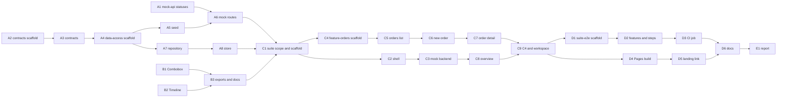

# Suite, plan 2: the Booking context end to end

**Spec:** [`2026-10-17-suite-booking-design.md`](../specs/2026-10-17-suite-booking-design.md).
Plan 1 ([kernel and Booking domain](2026-10-17-suite-1-kernel-and-booking-domain.md)) is merged;
this plan covers everything else in the spec. It replaces plans 2 to 4 named there with one plan
and four pull requests, as the spec's **Delivery** section lists them.

Written in autonomous mode (ADR 0027): the open questions are answered under **Assumptions**, and
every decision that is not hard to reverse is a row in the **Decision log**.

## Pull requests

| PR    | Branch                          | Title (squash commit)                                          | Tasks |
| ----- | ------------------------------- | -------------------------------------------------------------- | ----- |
| **A** | `feat/repo-booking-data-access` | `feat(repo): add Booking contracts, data access and mock API`  | A1–A8 |
| **B** | `feat/ui-combobox-timeline`     | `feat(ui): add the Combobox and Timeline components`           | B1–B3 |
| **C** | `feat/suite-app-orders`         | `feat(suite): add the suite app and the Booking order pages`   | C1–C9 |
| **D** | `feat/suite-e2e-pages-docs`     | `feat(suite): add BDD browser tests, the Pages build and docs` | D1–D6 |
| **E** | `docs/repo-suite-report`        | `docs: report on the suite Booking batch`                      | E1    |

A and B share no file and no blocking edge: they can run in parallel. C needs both. D needs C.

## Tasks

`[P]` marks tasks that may run at the same time as another `[P]` task: no shared file, no edge.

| Task | Files (at most five; config scaffolds count as one)                                                                                               | Covers                                                                            | Proves it                                                          | Blocked by |
| ---- | ------------------------------------------------------------------------------------------------------------------------------------------------- | --------------------------------------------------------------------------------- | ------------------------------------------------------------------ | ---------- |
| A1   | `libs/mock-api/src/lib/mock-api.interceptor.ts`, its spec, `libs/mock-api/README.md`                                                              | "the interceptor gains a way for a handler to return another status with a body"  | `npx nx test mock-api` (`answers with the status a handler gives`) | none       |
| A2   | scaffold `libs/booking/contracts` (project, tsconfigs, vite, eslint), `tsconfig.base.json`, `eslint.config.mjs` (`layer:contracts` rule)          | Boundary rule: contracts depend on domain only                                    | `npx nx lint booking-contracts`                                    | none       |
| A3   | `libs/booking/contracts/src/lib/{api,dto,events}.ts`, `events.spec.ts`, `README.md`                                                               | `OrderPlacedV1`, `OrderCancelledV1`, DTOs, API paths                              | `npx nx test booking-contracts`                                    | A2         |
| A4   | scaffold `libs/booking/data-access`, `tsconfig.base.json`, `eslint.config.mjs` (`layer:data-access`), `c4-containers.md`, `workspace.md`          | Boundary rule: data-access depends on domain, contracts, mock-api                 | `npm run check:architecture`, `npx nx lint booking-data-access`    | A3         |
| A5   | `libs/booking/data-access/src/lib/mock/seed.ts`, `seed.spec.ts`                                                                                   | Seed: 20 customers, 30 products, 14 days of slots, ~60 orders, every status       | `npx nx test booking-data-access -- seed`                          | A4         |
| A6   | `src/lib/mock/routes.ts`, `routes.spec.ts`, `src/mock.ts`                                                                                         | Every row of the spec's API table but `/api/suite/activity`; 409 with `code`      | `npx nx test booking-data-access -- routes`                        | A1, A5     |
| A7   | `src/lib/orders.repository.ts`, its spec                                                                                                          | Repository against the API paths, 409 and 5xx                                     | `npx nx test booking-data-access -- repository`                    | A4         |
| A8   | `src/lib/orders.store.ts`, its spec, `src/lib/failure.ts`, `src/index.ts`                                                                         | Store signals: loading, saving, business error by code, network error             | `npx nx test booking-data-access -- store`                         | A7         |
| B1   | `libs/ui/src/lib/combobox/{combobox.ts,combobox.spec.ts,combobox.stories.ts,README.md}` [P]                                                       | Combobox on the CDK with listbox semantics                                        | `npx nx test ui -- combobox`                                       | none       |
| B2   | `libs/ui/src/lib/timeline/{timeline.ts,timeline.spec.ts,timeline.stories.ts,README.md}` [P]                                                       | Timeline                                                                          | `npx nx test ui -- timeline`                                       | none       |
| B3   | `libs/ui/src/index.ts`, `docs/guide/components.md`, `libs/ui/README.md`                                                                           | "added to `docs/guide/components.md`"                                             | `npm run check:docs`, `npx nx build ui`, `npm run check:packages`  | B1, B2     |
| C1   | `commitlint.config.mjs`, `AGENTS.md`, `eslint.config.mjs` (`scope:suite`, `layer:feature`), scaffold `apps/suite`, `theme-init.spec.ts`           | `scope:suite` may depend on every business scope; the theme script in a 4th place | `npx nx build suite`, `npx nx test tokens`                         | A8, B3     |
| C2   | `apps/suite/src/app/layout/{shell.ts,shell.html,shell.spec.ts}`, `app.routes.ts`                                                                  | Shell: modules grouped, Booking active, SCM/Logistics/ERP disabled with "Soon"    | `npx nx test suite -- shell`                                       | C1         |
| C3   | `apps/suite/src/app/{mock-backend.ts,mock-backend.production.ts}`, `mock/activity.ts`, its spec                                                   | Event bus with the activity log; `GET /api/suite/activity`                        | `npx nx test suite -- activity`                                    | C1         |
| C4   | scaffold `libs/booking/feature-orders`, `src/lib/orders.routes.ts`, `src/lib/error-messages.ts` and spec                                          | Each `DomainError` code maps to a message                                         | `npx nx test booking-feature-orders -- error-messages`             | C1         |
| C5   | `src/lib/orders-list/{orders-list.ts,orders-list.spec.ts}`                                                                                        | Status tabs, search by id or customer, pagination, query in the URL               | `npx nx test booking-feature-orders -- orders-list`                | C4         |
| C6   | `src/lib/new-order/{new-order.ts,new-order.spec.ts,slot-picker.ts}`                                                                               | Customer combobox, editable lines, slot picker (radios), live totals, 409         | `npx nx test booking-feature-orders -- new-order`                  | C5         |
| C7   | `src/lib/order-detail/{order-detail.ts,order-detail.spec.ts,cancel-dialog.ts}`                                                                    | Lines, totals, status timeline, Confirm, Cancel with a reason in `ask-dialog`     | `npx nx test booking-feature-orders -- order-detail`               | C6         |
| C8   | `apps/suite/src/app/pages/{overview.ts,overview.spec.ts}`                                                                                         | Four KPIs, orders per day (`ask-chart`), the activity feed                        | `npx nx test suite -- overview`                                    | C3         |
| C9   | `c4-containers.md`, `workspace.md`, `docs/architecture/c4-components.md` if it lists apps                                                         | Map matches the new projects and edges                                            | `npm run check:architecture`, `npm run verify`                     | C7, C8     |
| D1   | scaffold `apps/suite-e2e` (project, playwright config with `defineBddConfig`, tsconfig), `package.json` (`playwright-bdd`)                        | `playwright-bdd` in `apps/suite-e2e`                                              | `npx nx e2e suite-e2e`                                             | C9         |
| D2   | `features/{place-order,cancel-order,orders-list}.feature`, `steps/*.ts`, `src/accessibility.spec.ts`                                              | The seven scenarios the spec lists; axe on every suite page, light and dark       | `npx nx e2e suite-e2e`                                             | D1         |
| D3   | `.github/workflows/ci.yml`, `CONSTRAINTS.md` (browser-flow and axe rows name `suite-e2e`)                                                         | CI's `e2e` job runs `suite-e2e` next to `dashboard-e2e`                           | CI `e2e` on the PR                                                 | D2         |
| D4   | `apps/suite/project.json` (`pages`), `routing-mode.pages.ts`, `scripts/assemble-pages.mjs`, `scripts/preview-pages.mjs`, `package.json` (`pages`) | Pages build at `/angular-saas-kit/suite/` with hash routing                       | `npm run pages`                                                    | C9         |
| D5   | `apps/landing/src/app/site-links*.ts`, the section that links the demo                                                                            | "The landing page links to it"                                                    | `npx nx test landing`                                              | D4         |
| D6   | `docs/guide/suite.md`, `docs/.vitepress/config.*`, `README.md` (roadmap), `docs/guide/development-process.md` (BDD is built)                      | Guide page, README roadmap entry                                                  | `npm run check:docs`, `npm run docs:build`                         | D3, D5     |
| E1   | `docs/superpowers/reports/2026-10-18-suite-booking.md`                                                                                            | The batch report                                                                  | `npm run check:docs`                                               | D6         |

Every requirement of the spec maps to a task: the projects and tags (A2, A4, C1, C4, D1), the
boundary rules (A2, A4, C1), the data flow and API (A6, A7, A8, C3), the event bus and activity
log (C3, C8), the seed (A5), errors (A8, C4–C7), UI (B1, B2, C2, C5–C8), testing (every task; D2
for the BDD files), delivery (D3–D6). The domain itself was plan 1.

## Definitions

- **Definition of Ready:** every field in the table is filled in.
- **Definition of Done:** the task's proving command passes; `npm run verify` and
  `npm run format:check` pass; the docs it touches are updated in the same pull request; no new
  `TODO`; an independent review (`review-change`, another agent) has no blocking finding left; the
  required checks are green.

## Assumptions

Questions the spec left open, answered here instead of asked.

1. **Order DTO.** The API returns `OrderDto`: the domain order's fields flattened (status, lines
   with `Money` values, `slotId`, `placedAt`, `cancelReason`), plus `customerName`, `createdAt`
   and the computed `totals`. The list returns `OrderSummaryDto` (no lines). A real backend must
   return the same; the DTOs live in `booking-contracts`.
2. **Two requests to place.** The New order page creates a draft (`POST /orders`) and then places
   it (`POST /orders/:id/place`), as the API table has it. If placing fails with 409, the draft
   stays and the page shows the error over the form; submitting again places the same draft.
3. **Overview data.** The spec's API table has no endpoint for the Overview KPIs.
   `GET /api/booking/overview` returns them (orders today, awaiting confirmation, revenue this
   week, cancellation rate over 30 days, orders per day for 14 days). Booking owns the figures, so
   the route lives with the Booking mock routes.
4. **Currency.** The seed is in VND only; the catalogue has no USD product. The domain still
   refuses mixed currencies.
5. **Slots.** The seed holds slots from 14 days back to 14 days ahead, so seeded placed orders
   reference real slots; `GET /slots` returns those from today to 14 days ahead. A slot's
   `booked` counts its non-cancelled orders, and a few future slots are filled to capacity.
6. **Mock entry point.** The mock routes and seed are a second entry point,
   `@angular-saas-kit/booking-data-access/mock`, so the main entry the feature imports does not
   carry them, and only the suite's `mock-backend.ts` (replaced in production) imports them.
7. **Statuses in `mock-api`.** A handler returns `mockResponse(status, body)` to answer with any
   status: 2xx becomes an `HttpResponse`, 4xx and 5xx an `HttpErrorResponse` with the body as
   `error`. Throwing an `HttpErrorResponse`, as the dashboard does, keeps working.
8. **Commit scope.** `suite` joins the commitlint scopes and `AGENTS.md` with the app. The
   Booking libraries use `repo`, as plan 1 did.
9. **The theme init script** goes into `apps/suite/src/index.html` too; `theme-init.spec.ts`
   checks it like the others, and `AGENTS.md` says four places.

## Decision log

| Decision                         | Options                                                  | Chosen and why                                                                                                    |
| -------------------------------- | -------------------------------------------------------- | ----------------------------------------------------------------------------------------------------------------- |
| Non-200 answers in `mock-api`    | throw `HttpErrorResponse`; a `mockResponse` return value | `mockResponse`: a handler can also answer 201, and a business refusal is not an exception in the handler's code   |
| Where the order list state lives | `OrdersStore`; a list query in the feature               | The feature, like the dashboard's `listQuery`: the URL owns it. The store owns the current order and the commands |
| Combobox popup                   | CDK Overlay; an inline listbox under the input           | Inline, positioned under the input: fewer moving parts, and CDK `ActiveDescendantKeyManager` gives the keys       |
| Four PRs over the 400-line limit | split further; keep the spec's four                      | Keep four: the person asked for the spec's split; each body says why it is larger                                 |
